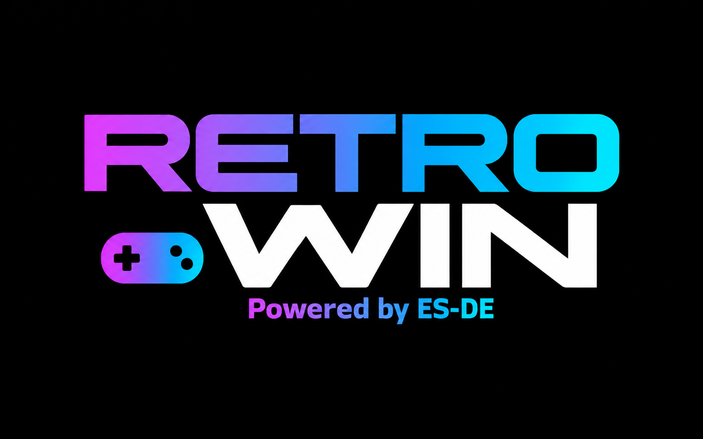

# RetroWin

🇮🇹 [Versione italiana](README.it.md)



**The RetroDECK experience on Windows, installed with a single command.**

RetroWin sets up [ES-DE](https://es-de.org) (portable), RetroArch with all its
cores, DuckStation and PCSX2 with the same folder layout and the same default
settings as [RetroDECK](https://retrodeck.net), plus a few Windows-specific
fixes. Your ROMs, BIOS files, saves and scraped media live in the same places as
in RetroDECK, so you can move your library between a Steam Deck and a Windows PC
without rearranging anything.


## Why RetroWin

- **One command, no hunting for downloads.** ES-DE, RetroArch (about 200 cores),
  DuckStation and PCSX2 are downloaded from their official sources and configured
  for you.
- **Same as RetroDECK.** Folder structure, emulator choices and settings follow
  RetroDECK, pinned to a specific RetroDECK version and updated in a controlled way.
- **Your library travels.** Copy `roms`, `bios`, `saves`, `states` and
  `ES-DE/downloaded_media` between RetroDECK and RetroWin and everything is
  where it should be. [RetroDECK Manager](https://github.com/cagekame/retrodeck_manager)
  can do the copying for you.
- **Player 1 is whoever presses a button first.** Windows numbers controllers in
  connection order, which you can't choose. RetroWin fixes that: when ES-DE starts,
  the first controller you press a button on becomes Player 1 in every system.
- **Updates keep your settings.** Running the installer again updates the programs
  and RetroDECK settings, but keeps everything you changed yourself.
- **Portable and tidy.** Everything lives in one folder (by default
  `%USERPROFILE%\RetroWin`), nothing is installed system-wide and no admin rights
  are needed.

## Install

Open **PowerShell** (no admin rights needed) and run:

```powershell
irm https://raw.githubusercontent.com/cagekame/RetroWin/main/bootstrap.ps1 | iex
```

When it's done, start **RetroWin** from the Desktop shortcut, put your ROMs in
`%USERPROFILE%\RetroWin\roms\<system>` and your BIOS files in
`%USERPROFILE%\RetroWin\bios`.

> The installer's messages are in Italian for now: it needs no input, just wait for
> the final summary.

With options (for example without PCSX2):

```powershell
& ([scriptblock]::Create((irm https://raw.githubusercontent.com/cagekame/RetroWin/main/bootstrap.ps1))) -SkipPCSX2
```

| Option | Effect |
|---|---|
| `-Root <folder>` | installation folder (default `%USERPROFILE%\RetroWin`) |
| `-SkipPCSX2` | don't install PCSX2 |
| `-Force` | download and reinstall the programs even if they are up to date |
| `-ResetConfig` | apply the RetroDECK settings again, then the RetroWin customizations (with `.bak` backups) |
| `-NoDesktopShortcut` | don't create the Desktop shortcut |
| `-Ref <tag/branch>` | `bootstrap.ps1` only: project version to use |

`bootstrap.ps1` downloads the latest release of this project into
`<Root>\Apps\_setup` and runs `install_retro_windows.ps1`. You can run the
installer as often as you like: it updates what's needed, skips the rest and never
deletes your files. At the end it writes a summary of the installation to
`<Root>\report_struttura.txt`.

## Systems and emulators

RetroArch comes with **all the cores** of the official package of the same stable
version (about 200 cores, 1.5 GB), like RetroDECK. The main ones:

| System | Emulator |
|---|---|
| NES | RetroArch – FCEUmm |
| SNES | RetroArch – Snes9x |
| Game Boy / Game Boy Color | RetroArch – Gambatte |
| Game Boy Advance | RetroArch – mGBA |
| Master System / Mega Drive / Game Gear / Sega CD (CD BIOS) | RetroArch – Genesis Plus GX |
| PC Engine / PC Engine CD (BIOS: `syscard3.pce`) | RetroArch – Beetle PCE Fast |
| Nintendo 64 | RetroArch – Mupen64Plus-Next |
| Sega Saturn | RetroArch – Beetle Saturn (BIOS: `sega_101.bin` JP, `mpr-17933.bin` US/EU) |
| Arcade / Neo Geo | RetroArch – FinalBurn Neo |
| Sega 32X | RetroArch – PicoDrive |
| Dreamcast | RetroArch – Flycast (BIOS: `dc\dc_boot.bin`) |
| Nintendo DS | RetroArch – melonDS DS |
| PSP | RetroArch – PPSSPP |
| Atari 2600 / 7800 / Lynx | RetroArch – Stella / ProSystem / Handy |
| Neo Geo Pocket, WonderSwan | RetroArch – Beetle NeoPop / Beetle Cygne |
| MSX, Commodore 64, Amiga, DOS | RetroArch – blueMSX / VICE / PUAE / DOSBox Pure |
| PlayStation | DuckStation |
| PlayStation 2 | PCSX2 (optional, `-SkipPCSX2` to skip it) |

BIOS files go in `<Root>\bios`.

## Updates

To update, just run the install command again.

- **Programs.** RetroArch (with its cores) and PCSX2 use the version RetroDECK
  specifies in `desired_versions.sh`, if any; otherwise the latest one. ES-DE uses
  the latest release, DuckStation the latest official release (RetroDECK uses its
  own Linux build). The installed version is written to `retrowin_version.txt` in
  the program folder: only what changed is downloaded, a program is never
  downgraded and, without a network connection, the installed version stays. The
  program archives contain no settings, so your settings survive updates.
- **RetroDECK settings.** They are pinned to commit `$RdCommit` of
  [RetroDECK/components](https://github.com/RetroDECK/components) (in
  `install_retro_windows.ps1`). The first time they are applied in full. When
  `$RdCommit` changes, the script compares the old RetroDECK settings, the new ones
  and your current ones entry by entry: an entry you never changed takes the new
  value, an entry you changed stays as it is, new entries are added. Then the
  RetroWin customizations are applied again. A `.bak` backup is made before every
  change.
- **ES-DE theme.** Pinned to a commit of RetroDECK-theme (`$RdThemeUrl`): it is
  reinstalled when that changes.

## What RetroWin changes compared to RetroDECK

- **Master System:** 4:3 full screen (RetroDECK uses "auto", 8:7 pixels).
- **RetroArch:** `sdl2` joypad driver, because RetroDECK's button bindings are
  numbered for SDL (with `xinput` the D-pad doesn't work and the analog stick's
  up/down are inverted).
- **DuckStation:** no console window next to the game; controllers read through
  SDL only (with XInput too, the same controller showed up twice); 4:3 picture
  with overscan cropping, 6x internal resolution, sharp pixel scaling (videos stay
  smooth), PGXP enabled and sharp sprite filtering.
- **Player 1 controller:** when RetroWin starts, the first controller you press any
  button on becomes Player 1 in every system, the other one Player 2.
  - DuckStation and PCSX2 follow Windows' controller order, so the script rewrites
    the controller number in their settings.
  - RetroArch sees the controllers in a different order and without their VID:PID
    code, so the script sets each player's "preferred device" by controller name
    (the name registered in Windows, cleaned up the way SDL does).
  - It's done by `tools/pad-giocatore1.ps1`, started by ES-DE as a "startup" event
    script; the result of the last start is in `Apps\RetroWin\pad-giocatore1.log`.
  - With two controllers of the same model RetroArch can't tell them apart and
    keeps its own order.
- **Branding:** RetroWin icon, splash screen and logos in the ES-DE theme.

## Customizing

The differences from RetroDECK live in `custom/` and are applied **on top of** the
RetroDECK settings. Only the entries that change are written, so updates of the
RetroDECK settings keep coming.

```
custom/
  overrides/
    retroarch.cfg                 key = "value"
    retroarch-core-options.cfg    key = "value"
    core-options/<core>/<roms folder>.opt   core options for that folder only
    duckstation.ini               [Section] + Key = Value
    es_settings.xml               <type name="Name" value="Value" />
  files/                          copied as they are into <Root> (same structure)
  branding/
    RetroWin.png                  the icon is generated from it (or RetroWin.ico)
    splash.png                    ES-DE startup screen (or splash.svg / splash.jpg)
```

Customizations are applied when they change, when the RetroDECK settings are
applied or with `-ResetConfig`. Changes you make from the emulators' menus stay
until you change the files in `custom/`. Paths (ROMs, BIOS, saves...) are managed by
the script: don't put them in the overrides.

## Project structure

```
bootstrap.ps1               downloads the project from GitHub and starts the installation
install_retro_windows.ps1   installation settings and steps
lib/
  common.ps1                messages, folders, downloads, archives, links, backups
  config.ps1                settings files and RetroDECK settings updates
  programs.ps1              installing and updating the programs
  branding.ps1              icon and splash screen
tools/
  pad-giocatore1.ps1        when ES-DE starts: the first controller used becomes Player 1
custom/                     RetroWin customizations (see above)
```

`install_retro_windows.ps1` needs `lib/` and `custom/` next to it: run it from a
full copy of the project (`bootstrap.ps1` downloads one for you). From a local
copy:

```powershell
powershell -ExecutionPolicy Bypass -File .\install_retro_windows.ps1 -SkipPCSX2
```

### Releasing a new version

1. Change and test locally (`install_retro_windows.ps1`). To follow a newer
   RetroDECK, set `$RdCommit` (and `$RdThemeUrl` if needed) to the wanted commit.
2. Commit and push to `main`.
3. Create a GitHub release with a new tag (e.g. `v1.3.1`): `bootstrap.ps1` always
   uses the latest release, so installations never pick up half-finished changes.

ROMs, BIOS files and saves must never be committed.

## License

Released under the [MIT License](LICENSE). RetroWin is an independent project and
is not affiliated with the RetroDECK team; ES-DE, RetroArch, DuckStation and PCSX2
have their own licenses and are downloaded from their official sources.
